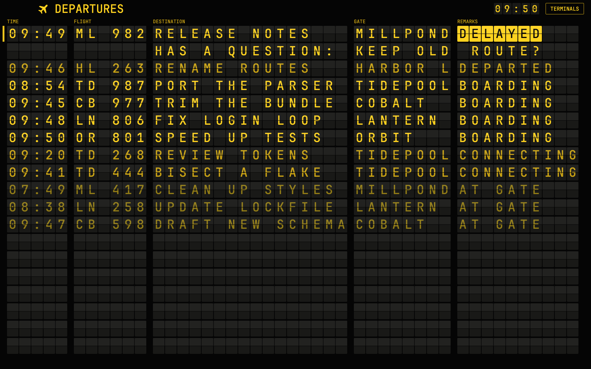

# Departures

An airport split-flap board for Herdr: each coding agent is a flight, and anyone who needs you flips to the top as DELAYED.

A layout for the [Herdr](https://github.com/ogulcancelik/herdr) desktop app. Built for macOS. Its checks pass on Windows, and it hasn't yet been run in a real window.

Ask your agent to add it from [herdr.dev/layouts](https://herdr.dev/gallery/?type=layouts), or point it at this repo. It reads [the recipe](RECIPE.md) and every file first.

For screenshots and GIFs, set `"props": { "demo": true }` on the `board` block in `layouts/departures.json`. It runs made-up flights and needs no agents.

`node --test` runs the tests. `scripts/make-clack.js` remakes the sound and needs ffmpeg.

MIT, see `LICENSE`.
