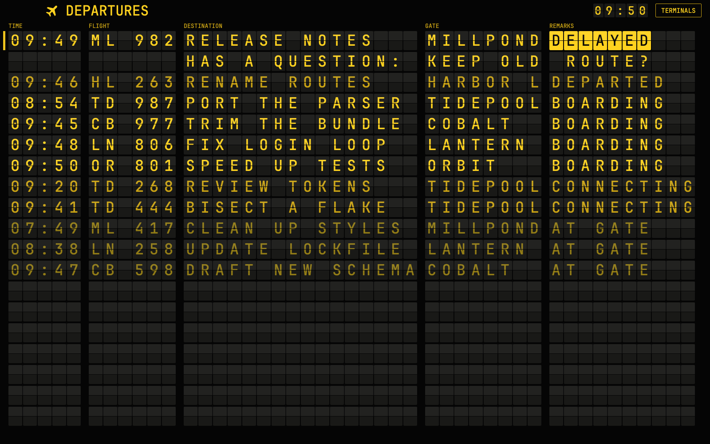

# Departures

An airport split-flap board across the top of the window, with every coding agent as a flight. Yellow letters on black cells say when each agent took its state, what it's working on, which space it's in and how it's doing. When something changes the letters flip through the drum to the new word, and an agent that needs you turns over a black-on-yellow DELAYED and rises to the top with its reason. Your terminals stay in view underneath, and pressing a row goes to that agent.

## What you see

Top to bottom, filling the window, with no title bar. Sizes are for a 1440px wide window, because the board's cells grow with the window.

1. **The board**, 400px high, on `#050505`. Drag its lower edge to resize it, from 100px to 760px, and it shows as many rows as fit.
   - **Header**, 42px: a yellow plane icon and DEPARTURES at 27px on the left. On the right, PAGE 1/2 at 12px in amber when there's more than one page, the time as five small flap cells, and a TERMINALS button: 26px high, 1px amber border, 12px yellow text. On a folded board the button reads BOARD.
   - **Column labels**, 19px, 11px amber: TIME, FLIGHT, DESTINATION, GATE, REMARKS, each over the first cell of its column.
   - **Rows**, 8 of them, 41px apart: cells 27px wide and 38px high, 2px apart, with 14px between columns and 16px margins. Columns are 5, 6, 17, 8 and 10 cells wide. Type is JetBrains Mono, weight 700, 29px, in capitals.
   - **A cell** is `#191917` with 2px corners and a lighter top half (`#ffffff0a`). A 1px `#050505` hairline crosses its middle.
   - Rows with nothing on them stay on the board as blank cells.
2. **The window underneath**, the rest of the height: the same as Herdr's main layout. Spaces sidebar (268px) on the left, tab bar, terminals in cards, the Files and Changes panel, the status bar. The agents list in the sidebar is hidden, because the board does its job.

Colors: yellow `#ffd21f`, amber `#c9a214`, dim `#927c16`, falling flap `#2b2a24`, a row under the pointer `#2a2406`. The layout sets the rest of the window to match: terminals `#0b0b0a`, `chrome` `#0e0e0c`, `border` `#2b2a24`, `accent` `#ffd21f`.

A window from 1100px up gets the same 45 or 46 cells across with larger or smaller type, so the board reads the same as a 390px thumbnail. Past 38px per cell, extra width goes to DESTINATION, up to 32 cells.

## How it behaves

| Status | REMARKS | Row color | Order |
| --- | --- | --- | --- |
| blocked | DELAYED, black on yellow, with its reason on a second row | yellow | first, oldest first |
| done | DEPARTED | amber | second |
| working | BOARDING | yellow | third |
| a sub-agent | CONNECTING | amber | fourth |
| idle | AT GATE | dim | last |

- **TIME** is when the agent took its current remark, as `HH:MM` in local time. It comes from the terminal's `status_ms` when there is one, and otherwise from when the board first saw it.
- **FLIGHT** is two letters from the space and three digits from the agent's address, like `LN 204` for an agent in `lantern`. An agent keeps its code, even if its space is renamed.
- **DESTINATION** is the tab's name if someone named it, else the terminal's name, then its title, then the program. It's cut to fit.
- **GATE** is the space's name, cut to 8 letters. A sub-agent gets its parent's.
- **A sub-agent** that is blocked or stopped on an error reads DELAYED, like anyone else. Otherwise it reads CONNECTING. A terminal started from a plain shell isn't a sub-agent and isn't on the board.
- **The reason** is the terminal's `report.msg`, else "needs permission", "has a question" or "needs a sign-in" from its kind, else "stopped on an error" or "waiting on you". It runs from under DESTINATION to the end of the row.
- **A blinking bar**, 4px wide and yellow, sits left of each DELAYED row, fading between 25% and 100% every 1.2s.
- **Done rows clear** 5 minutes after they departed. If anyone looks at the agent first it turns idle and reads AT GATE. A cleared agent comes back when its status changes.
- **The flip:** a cell runs forward through the drum ` A-Z 0-9 : - . / ' & + # ?` and shows at most its last 5 letters. Each letter is two 50ms frames: the new letter's top half on a `#2b2a24` flap over the old letter's bottom half, then the whole new letter. The wave crosses two cells a frame from the left, and each changing row starts one frame after the last. Only cells whose letter changes move. The longest flip takes about 2 seconds. A DELAYED remark turns black on yellow a cell at a time, as each lands.
- **The clack:** a soft double tap when a row changes, at most once a burst and at least 1.2s apart. It follows the Sounds setting. The first fill of the board and page turns are silent.
- **Paging:** when flights don't fit, the board turns the page every 8 seconds. DELAYED rows stay at the top of every page unless they would fill it, and then they take turns too. The page holds while the pointer is on the board.
- **Empty:** NO DEPARTURES in the middle row, inside DESTINATION.
- **Press a row**, or its reason: `pane.focus` on that agent's pane, which shows its terminal below. A sub-agent with no pane opens with `terminal.peek`. The agent keys (`agent.next`, `agent.prev`) follow the board's order.
- **TERMINALS** folds the board to its header and two rows, 151px, so the most urgent flight and its reason stay in view and the terminals take the rest. BOARD, or `ctrl-shift-d`, brings it back to the height it had. The fold asks for 3px more than two rows need, because the block can come back a pixel short.
- **Dragging** the header or the labels moves the window.
- **Demo mode:** with `"props": { "demo": true }` on the board's block, 11 made-up flights run a 12-step story, a step every 2 seconds, on a clock where a step is one minute. It needs no agents and repeats exactly. Rows do nothing when pressed.

## Built from

- **The layout** (`layouts/departures.json`): Herdr's main layout, keeping `cloned_from`. Its root becomes a `column` with `titlebar: "none"`, `traffic_lights: [12, 16]`, `theme: "graphite"`, its own `colors`, JetBrains Mono for `font` and `ui_font`, and `preview: "mods/departures/preview.svg"`.
  - `board`: a `block`, `size: { px: 400 }`, `min: 100`, `max: 760`, `window_drag: true`, content `{ mod: "departures" }`.
  - `body`: a `row` holding main's `sidebar` and `work` nodes as they are, except `agents` has `hidden: true`.
- **One mod** (`mods/departures/`), `mod.json` `{ "place": "none", "title": "Departures" }`:
  - `logic.js`: the rules, importing nothing. Remarks, flight codes, sorting, paging, sizes, and `Flaps`, the grid that flips.
  - `demo.js`: the story, as fake `agents()` and `terminals()` that go through the same rules.
  - `view.js`: the drawing. `main.js`: the state and timers.
  - `props`: only `demo`.
- **Shipped mods it uses** through main's nodes: `workspace-chrome`, `spaces`, `tabs`, `pane`, `files`, `changes`, `workspace-status`.
- **Herdr functions:** `agents`, `terminals`, `settings`, `window`, `props`, `run`, `playSound`, `setAgentOrder`, `nextCommand`.
- **Commands:** `pane.focus`, `terminal.peek`, `layout.resize`.
- **Timers:** `cx.timer.every` at 10,000ms for the clock and clearing done rows, and at 8,000ms for pages. `cx.timer.after` at 50ms, asked for one tick at a time during a flip and not otherwise. Demo mode adds `cx.timer.every` at 2,000ms. The bar uses native `.loop("opacity", ...)`.
- **Key:** `keys.json` binds `ctrl-shift-d` to `departures.fold` in the `layout:departures` section. Merge it into the person's own.
- **Art:** `plane.svg`, `preview.svg`, and `clack.mp3`, 0.18s, generated by `scripts/make-clack.js` from arithmetic. That script needs ffmpeg, and only to remake the sound.
- **Programs:** none.

## Watch out

- **What it runs and reads:** it runs no programs and makes no network calls. It reads the live lists from `agents()` and `terminals()`, including terminal names, titles and status messages, and reads no files. It keeps when each agent changed, its flight code and the board's open height in this mod's `localStorage`.
- **Built for macOS, tested this far:** `herdr-app check` and `node --test` pass on Windows and macOS. On macOS with Herdr 0.1.13 at zoom 1.2, in a private window with real Claude Code sessions, keys and clicks: the layout and its fonts, BOARDING to DELAYED with its reason, DEPARTED clearing after 5 minutes, CONNECTING and its peek, pressing a row, TERMINALS, BOARD and `ctrl-shift-d`, dragging the edge, paging with DELAYED kept on every page, no redraws between clock minutes, and demo mode. The clack has been asked for at the right moments but not yet listened to.
- **Timers:** a mod has no `setTimeout`, `setInterval` or `clearTimeout`. Calling one breaks the mod.
- **Don't use `.frames` for the flip.** It runs forever on a clock every view shares, so a flip can't start on its first letter or stop on its last.
- **Redraws:** every redraw redraws the whole window, so a flip costs up to 20 redraws a second for its 2 seconds. Keep the next tick behind "is anything still moving", and keep a change-free board at no redraws. With many agents every page turn is a flip. The bar's native loop runs while a DELAYED row shows.
- **Cost per cell:** a cell at rest is one element, and the hairline is one element per row. Don't give each cell its own halves unless it's falling.
- **Sizes:** `on_size_change` reports window pixels, while `.w()` and `.text_size()` are scaled by the zoom. Divide by `settings().zoom` or the board overflows. The grid is worked out in whole window pixels and handed back in the app's units, because the app rounds each element to whole pixels: at a zoom of 1.2 a 22 unit cell drew 26 pixels, and the sheen and column labels, placed by adding widths up, drifted off the cells by up to 40 pixels.
- **Names that must match:** the node id `board` and its 400px with `BLOCK` and `OPEN_PX` in `main.js`.
- **Presses:** rows and the button need `.on_mouse_down("left", ...)` with `cx.stop_propagation()`, or the block's `window_drag` takes them.
- **Colors** are fixed in `view.js` and don't follow the theme. The theme picker changes only what's under the board.
- **Hidden agents list:** it's hidden because it sets the agent key order too. On macOS its button is how a sidebar folded to a rail unfolds, so here you drag the sidebar's edge instead.
- **Under the board on macOS:** the window buttons sit over the board's header, which leaves them room. The `brand` row keeps its own 76px gap all the same.
- **The terminals give up 400px.** On a short window, fold the board or drag it smaller.
- **Limits:** DESTINATION shows about 16 letters and a reason about 35. Letters outside the drum become spaces, so a name in another script may show as blank and fall through to the next name. A press during a page turn goes to the row's new flight.
- **Keys:** `ctrl-shift-d` is new here and may clash with a person's own binding.
- If `departures` is taken, rename the layout file, the `mod` name, the `layout:departures` key section and the `mods/departures/` paths in `main.js`, `view.js` and the layout.

## Done when

- `node --test` passes from the repo's top folder.
- `herdr-app check mods/departures` passes.
- `mods/departures/` has no `setTimeout`, `clearTimeout` or `setInterval`.
- With no agents, the board reads NO DEPARTURES.
- A working agent reads BOARDING. When it blocks, its letters flip, it moves to the top reading DELAYED with its reason on the next row, and one clack plays.
- With Sounds off, the same change flips in silence.
- A done agent reads DEPARTED and leaves the board 5 minutes later.
- A sub-agent reads CONNECTING, and pressing it opens a peek.
- Pressing a row focuses that agent's terminal. TERMINALS folds the board to two rows, and BOARD brings it back.
- With more flights than rows, the page turns about every 8 seconds, silently, and DELAYED rows stay on every page.
- A board with nothing changing doesn't redraw between clock minutes.
- With `"props": { "demo": true }`, the board runs with no agents.
